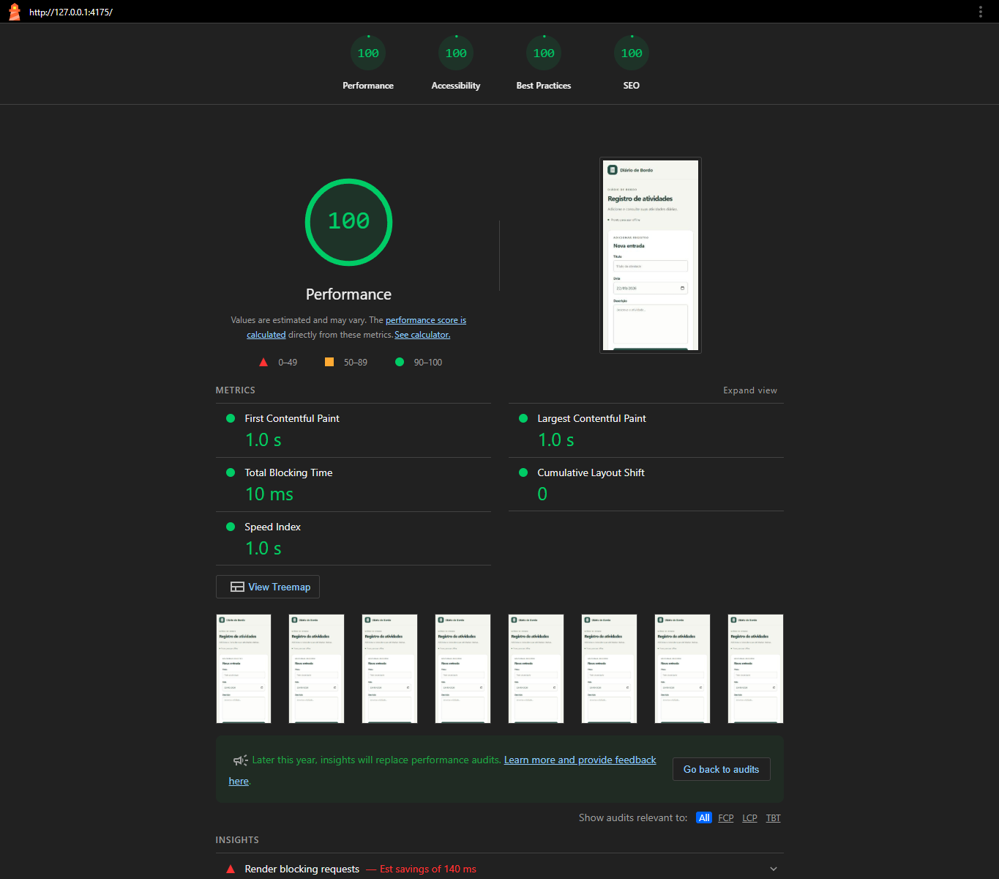

# Diário de Bordo — otimização de performance

PWA para registrar atividades diárias (criar, listar e remover), com dados em `localStorage`, instalável e funcional offline. HTML, CSS e JavaScript puros, sem framework. O projeto documenta um ciclo completo: diagnóstico, correção, medição antes/depois e um servidor Python de produção.

## Resultados

Lighthouse mobile, mediana de 3 execuções por versão, com 365 registros (um ano de uso). Medições de 22/09/2026.

| Métrica | Antes | Depois | Variação |
|---|---:|---:|---:|
| Notas Lighthouse (4 categorias) | 100 | 100 | Mantidas |
| TBT (bloqueio da thread principal) | 91,5 ms | 11,0 ms | −88,0% |
| LCP / FCP | 1.097,7 ms | 1.016,0 ms | −7,4% |
| Transferência observada | 15.569 B | 13.070 B | −16,1% |
| Renderização da lista, 365 itens (CPU 4× mais lenta) | 183,5 ms | 35,0 ms | −80,9% |
| Peso dos arquivos da aplicação | 20.427 B | 15.157 B | −25,8% |

A nota já estava em 100 antes das mudanças: o ganho está nos tempos e no volume transferido, não na pontuação. Foram medições de laboratório e variam entre execuções (o TBT "antes" oscilou de 0 a 108 ms); por isso a tabela usa medianas.

**Método:** Lighthouse 12.8.2 e Chrome for Testing 147 em modo headless, perfil de 412×823 px, rede simulada (RTT 150 ms, 1.638,4 Kbps), CPU 4× mais lenta, perfil novo a cada execução, mesmo servidor e mesmos dados nas duas versões, sem compressão HTTP em nenhuma delas.

| Antes | Depois |
|---|---|
|  |  |

Evidências: relatórios completos [antes](docs/relatorios/antes.html) e [depois](docs/relatorios/depois.html), [medições originais](docs/relatorios/medicoes/), [comparativo.json](docs/relatorios/comparativo.json) e [benchmark.json](docs/relatorios/benchmark.json).

## O que foi feito

- **Formatação de datas:** a listagem criava 365 `Intl.DateTimeFormat` a cada atualização; agora reutiliza uma instância. Foi a maior redução isolada de JavaScript (124,5 → 17,0 ms).
- **Lista longa:** montagem em `DocumentFragment`, um único listener por delegação de eventos e `content-visibility: auto` nos cartões, que adia o layout do que está fora da tela.
- **Imagens:** o cabeçalho passou de PNG 192×192 para WebP sem perdas de 84×84 (exibido a 42×42, −41,7%); os ícones de instalação foram comprimidos.
- **Build:** minificação de HTML, CSS, JavaScript e manifest (html-minifier-terser, clean-css, Terser).
- **Cache do service worker:** o nome do cache era fixo (`performance-v1`), então quem já tinha visitado o app continuava recebendo CSS e JavaScript antigos após uma atualização. Agora o nome é um hash do conteúdo, calculado no build, e cada versão nova cria o cache novo e remove o anterior.
- **Servidor Python (FastAPI):** serve o `dist/` com gzip, ETag e cabeçalhos de segurança, incluindo uma Content-Security-Policy restritiva.

## Como executar

Requer Node.js 22 ou superior.

```powershell
npm ci
npm run build
npm run dev
```

O servidor de desenvolvimento fica em **http://localhost:8081**. O modo offline e a instalação exigem localhost ou HTTPS.

### Servidor de produção (Python)

```powershell
py -m venv .venv
.\.venv\Scripts\python.exe -m pip install -r server/requirements.txt
.\.venv\Scripts\python.exe -m server
```

Fica em **http://localhost:8000**, com `/healthz` para checagem de saúde. Variáveis opcionais: `HOST` (padrão `127.0.0.1`), `PORT` (`8000`) e `DIST_DIR` (`dist/`). Exige o build prévio. Os arquivos não têm hash no nome, então todos são servidos com `Cache-Control: no-cache` e ETag: o navegador revalida (304) e o service worker entrega o carregamento rápido e offline. Fora do localhost, publique atrás de um proxy com HTTPS.

### Testes

```powershell
npm test
.\.venv\Scripts\python.exe -m pip install -r server/requirements-dev.txt
.\.venv\Scripts\python.exe -m pytest
```

`npm test` cobre o hash do cache e o build (determinismo, mudança de 1 byte, falha sem o marcador). O `pytest` cobre o servidor, incluindo o `dist/` real; sem o build, os testes de integração falham.

### Reproduzir as medições

```powershell
$env:CHROME_PATH = 'C:\Program Files\Google\Chrome\Application\chrome.exe'
npm run audit -- antes
npm run audit -- depois
npm run benchmark
npm run reports
```

Cada execução grava em `docs/relatorios/` e **substitui** as evidências atuais. A reprodução exata exige as mesmas versões de Chrome e ferramentas; os tempos variam conforme a máquina.

## Estrutura

```text
src/        Código-fonte e imagens originais
dist/       Aplicação otimizada, pronta para hospedagem
server/     Servidor de produção em Python (FastAPI)
tools/      Build, servidor de desenvolvimento, auditoria, benchmark e testes
tests/      Testes do servidor (pytest)
docs/       Versão original (baseline) e relatórios das medições
```

## Limites

- As medições são anteriores ao versionamento do cache e ao servidor Python e **não foram refeitas**. A única mudança em arquivo publicado foi o `service-worker.js` (976 → 974 B).
- O ganho de cada mudança de renderização, além do formatador de datas, não foi medido separadamente.
- O DOM mantém todos os registros (preserva a navegação e a busca na página); `content-visibility` reduz o trabalho de renderização, não a contagem de elementos. A folha de estilos continua bloqueante, agora menor.
- O servidor Python foi validado por testes automatizados e em Chrome headless no localhost (atualização do cache, uso offline, ausência de erros de CSP), com Python 3.14. Instalação do PWA, HTTPS e hospedagem real não foram validados, e o gzip não foi medido com o Lighthouse.
